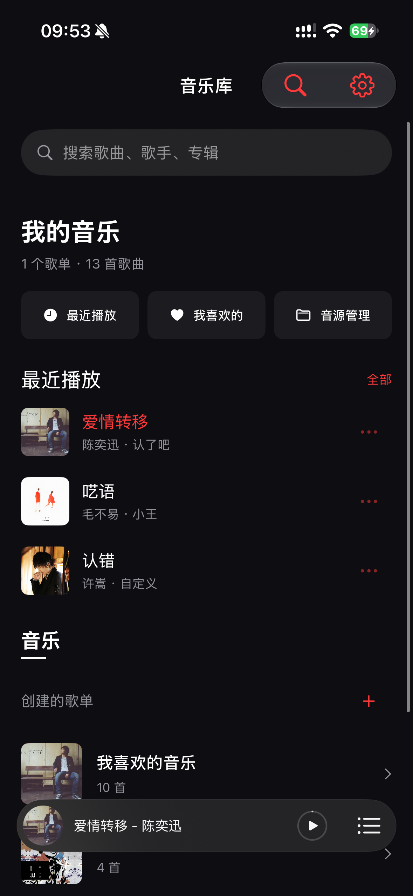
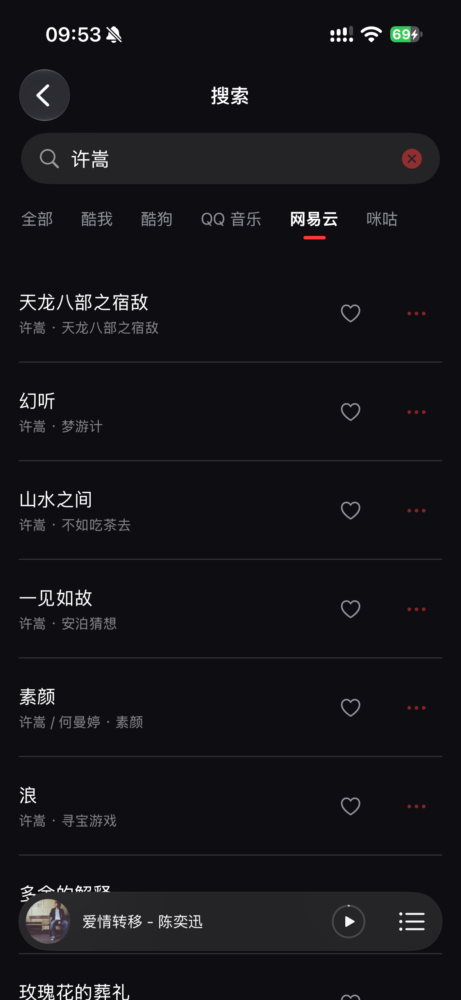
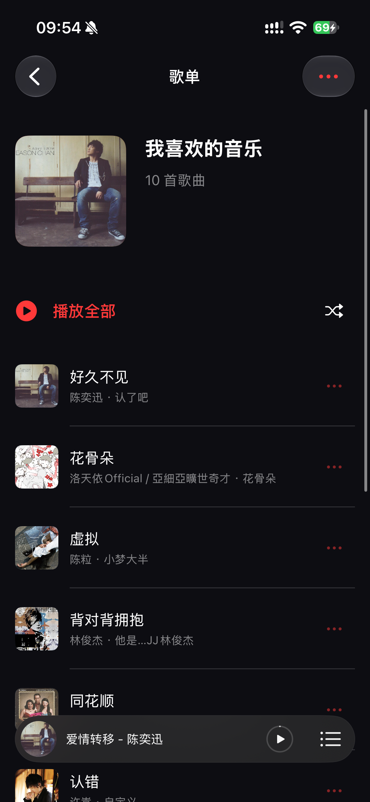
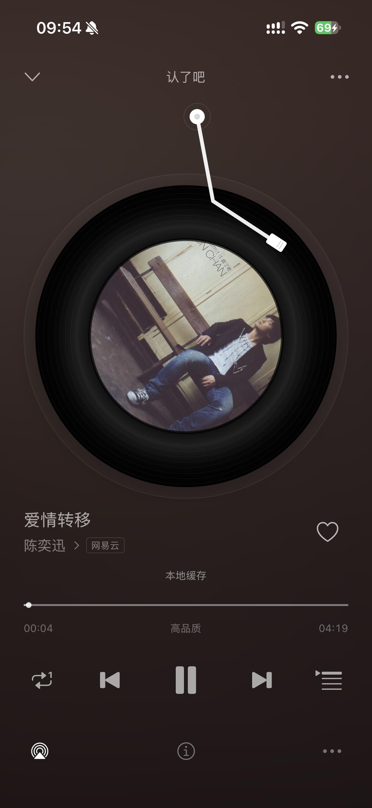
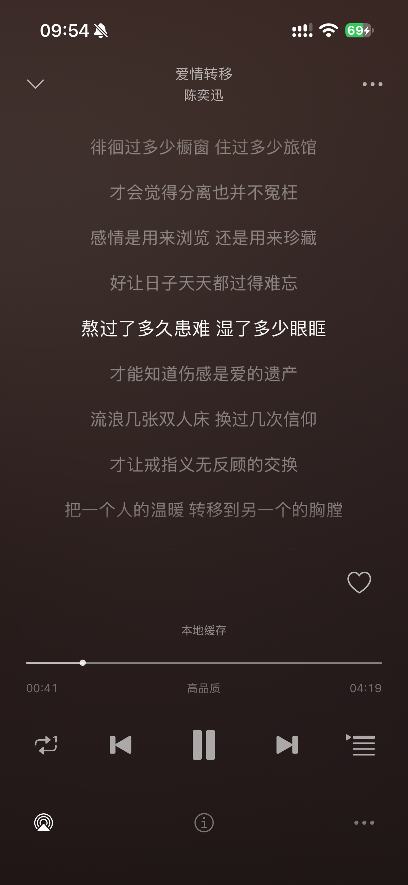

<div align="center">
  
  <h1>拍点 · PaiDian</h1>
  <p>点开，就有节奏。</p>
  <p>一个专注歌单、黑胶与歌词的原生 iPhone 音乐播放器。</p>
  <p>
    <a href="https://github.com/Wang-mis/PaiDian/releases/latest">下载 Release</a> ·
    <a href="docs/BUILDING.md">构建与安装</a> ·
    <a href="docs/SOURCES.md">内置音源</a> ·
    <a href="LICENSE">MIT License</a>
  </p>
</div>

## 界面预览

以下为 iPhone 16 实机截图，依次展示音乐库、搜索、歌单、黑胶播放器与歌词。截图中的音乐内容仅用于界面展示，仓库和安装包不包含歌曲音频。

<table>
  <tr>
    <td align="center"><br />音乐库</td>
    <td align="center"><br />聚合搜索</td>
    <td align="center"><br />个人歌单</td>
  </tr>
</table>
<p align="center">
  
  
</p>

## 功能

- **聚合搜索**：支持网易云、QQ 音乐、酷狗、酷我和咪咕的歌曲搜索与平台筛选。
- **开箱导入音源**：随附 10 个第三方源脚本，首次启动在后台导入；支持文件和 URL 导入、手动排序及按音质范围回退。
- **自己的音乐库**：本地歌单、收藏、封面、最近播放与搜索历史，无需应用账号或自建服务器。
- **封面补全**：酷我、酷狗歌曲按需获取封面，兼容已有歌单；播放器、歌单与锁屏共享缓存。
- **沉浸播放**：黑胶唱片与唱臂、悬浮迷你播放器、顺序播放、列表循环、单曲循环和随机播放。
- **同步歌词**：多平台歌词解码、译文、歌词定位、逐曲时间偏移及字号/行距设置；逐字格式统一为逐行显示。
- **缓存与系统集成**：当前曲整首缓存、完整缓存离线续播、1/2/5 GB 容量设置，支持后台、锁屏与耳机控制。
- **原生实现**：SwiftUI、SwiftData、JavaScriptCore、AVPlayer，无第三方运行时依赖，最低 iOS 17。

## 下载与安装

前往 [Releases](https://github.com/Wang-mis/PaiDian/releases) 下载 **未签名 IPA**，使用自己的签名身份重新签名后安装。未签名文件无法直接安装，不包含开发者个人证书或设备描述文件。

也可以使用 Xcode 打开 `PaiDian.xcodeproj`，选择 `PaiDian` Scheme 和自己的开发 Team 后运行。构建环境、覆盖安装及验证命令见 [构建与安装](docs/BUILDING.md)。

首次打开时，内置音源在后台逐个导入。等待音源管理中出现条目后即可搜索；初始化失败会展示原因。已有安装的音源、排序、歌单和设置会保留。详见 [内置音源说明](docs/SOURCES.md)。

## 使用

1. 打开音乐库，等待内置音源完成初始化，或在“音源管理”中导入自己的脚本。
2. 搜索歌曲，点按播放；通过歌曲菜单收藏或加入歌单。
3. 点按底部播放条展开播放器，点按唱片切换歌词，选择歌词行并确认可跳转。
4. 在设置中调整音质范围、歌词显示、外观及缓存容量。

音源、曲库和音频服务由第三方提供。内置脚本是版本快照，服务可用性随平台、歌曲、网络和脚本版本变化；搜索到歌曲不等于能够播放。缓存由系统管理，不能代替永久下载或备份。

## 开发与验证

```sh
zsh scripts/run_core_tests.sh
python3 scripts/generate_project.py
```

当前本机 **36 组核心验证及 12 项播放协调回归通过**，包括内置音源首次导入、已有用户保留、中断恢复、失败条目保留和摘要校验。模拟器测试 Target 构建与 iPhone 真机签名构建已验证；联网音源结果不作为持续可用性保证。

源码按 Domain、Infrastructure、Sources、Catalog、Search、Persistence、Queue、Playback、Lyrics、Features/App 组织。生成未签名 Release：

```sh
zsh scripts/package_release.sh
```

## 许可证与致谢

拍点原创代码使用 [MIT License](LICENSE)。歌词算法参考 AnyListen Online Metadata，保留 Apache-2.0 声明；内置音源、专辑封面及歌词保留相应权利人的权利，**不因随附本项目而改为 MIT**。详情见 [第三方声明](NOTICE.md)。

请在获得相应授权的范围内使用音源与音乐内容。本项目不提供歌曲音频文件或音乐托管服务。
